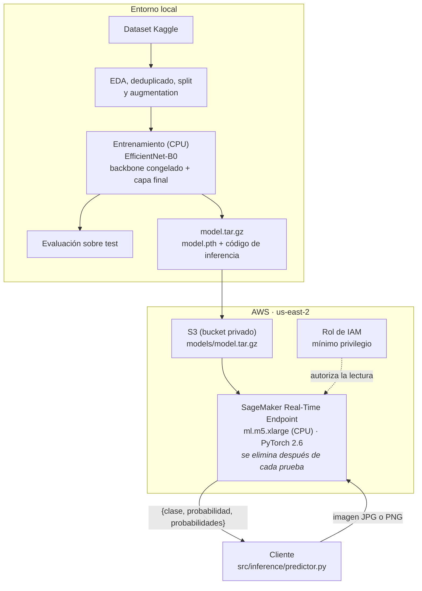
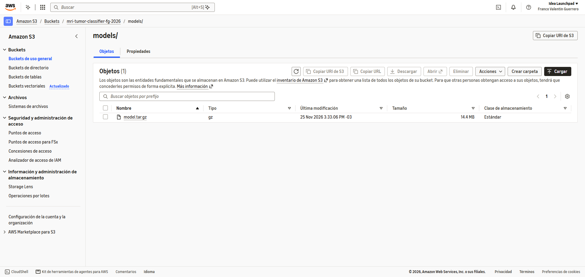
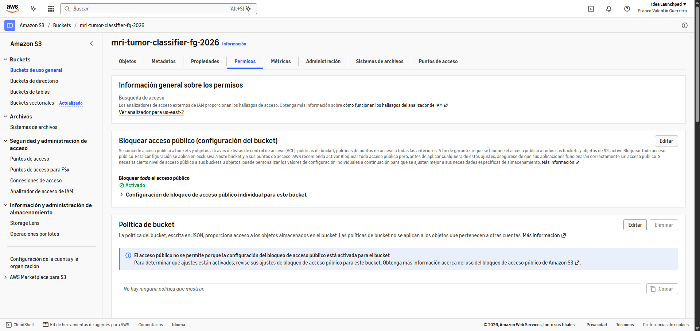
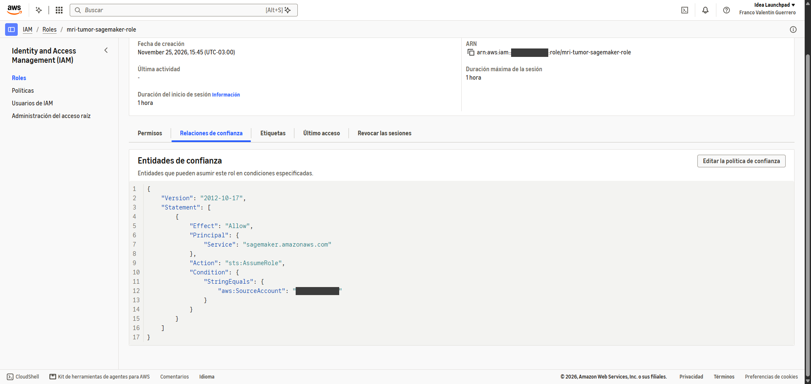
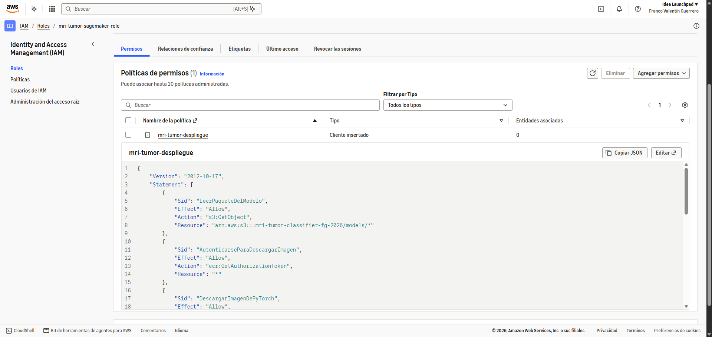
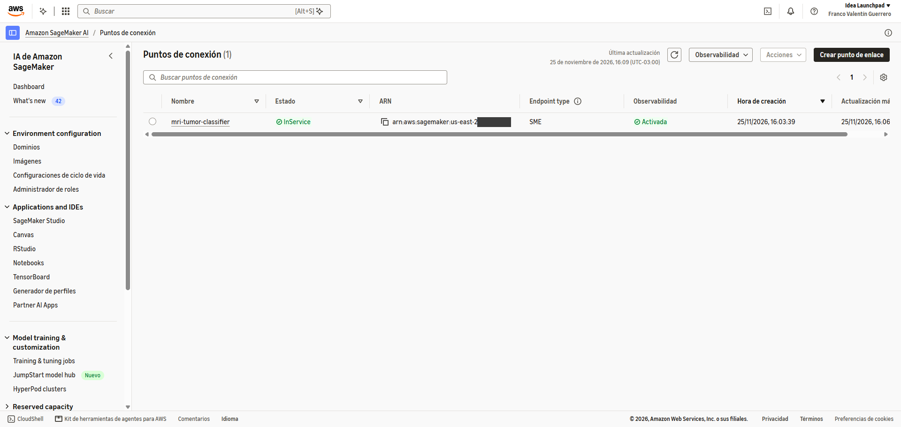
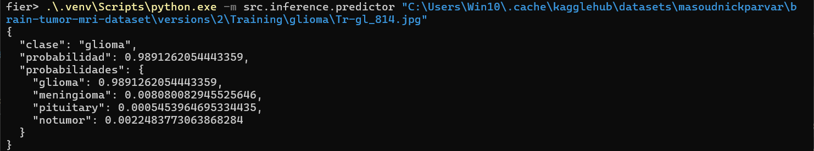
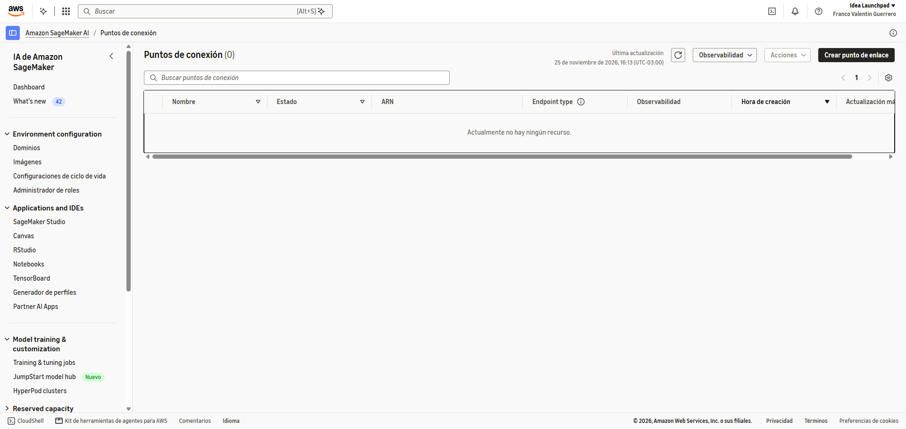
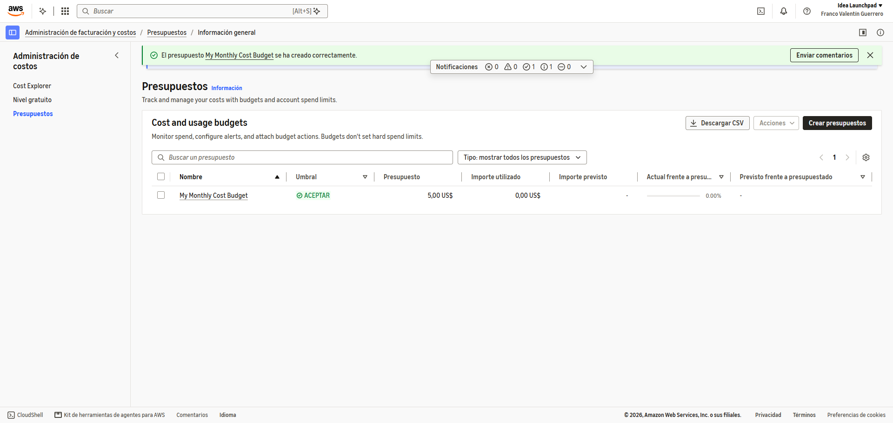

[⬅ Volver al README](../README.md)

# Arquitectura del proyecto

## Resumen

Divido el proyecto en dos fases: prototipado en entorno local (análisis, preparación de los datos, entrenamiento y evaluación) y despliegue en AWS. El modelo entrenado y evaluado localmente se publica como un servicio en SageMaker, que recibe una imagen y devuelve la clase y sus probabilidades.

## Diagrama de flujo

## Estado de cada componente (25/11/2026)

| Componente | Estado | Implementación |
|---|---|---|
| Bucket de S3 | Creado | Privado, cifrado (AES-256), con todo el acceso público bloqueado |
| Paquete del modelo | Subido a S3 | `scripts/package_model.py` |
| Rol de IAM | Creado | `scripts/create_sagemaker_role.py` |
| Endpoint | Desplegado, probado y eliminado | `scripts/deploy_endpoint.py` |
| Cliente | Implementado | `src/inference/predictor.py` |
| Alerta de gasto | Creada | AWS Budgets: US$ 5 por mes, con avisos por correo al 85% y al 100% del gasto, y al 100% del gasto previsto |
| Training Job | No ejecutado: la cuota de la cuenta es 0 y el aumento está solicitado | `scripts/launch_training_job.py` (sin implementar) |
| SageMaker Pipelines | Opcional, no implementado | `src/pipeline/sagemaker_pipeline.py` (sin implementar) |

## Prueba del despliegue (25/11/2026)

| Verificación | Resultado |
|---|---|
| Código de inferencia en local contra la evaluación inicial de test (1.403 imágenes) | Matriz de confusión idéntica |
| Paquete descargado de S3 ejecutado con PyTorch 2.14 y con 2.6 (1.403 imágenes) | 0 diferencias de clase; diferencia máxima de probabilidad: 0,0000017 |
| Endpoint contra el resultado local (40 imágenes de test, 10 por clase) | 0 diferencias de clase; diferencia máxima de probabilidad: 0,0000015 |
| Tiempo de respuesta del endpoint (mediana, desde Argentina) | 0,9 segundos por imagen, incluida la red |
| Tiempo de creación del endpoint | 3 minutos |
| Permanencia del endpoint | 8 minutos (costo estimado: US$ 0,03) |

Las 40 imágenes verifican que el endpoint responde igual que el modelo local. No son una medición de desempeño: para eso se utiliza el conjunto de test completo (ver [model card](model_card.md)).

## Evidencias del despliegue

Capturas del 25/11/2026. El número de cuenta de AWS está tapado.

**1. Paquete del modelo en S3.** El archivo `model.tar.gz` en la carpeta `models/` del bucket.

**2. Bucket privado.** El bloqueo de todo el acceso público está activado.

**3. Quién puede utilizar el rol.** Solo el servicio SageMaker, desde la propia cuenta.

**4. Qué puede hacer el rol.** De S3, únicamente leer `models/`. El permiso con `"Resource": "*"` corresponde a una acción que AWS no permite restringir a un recurso.

**5. Endpoint activo.** Estado `InService`.

**6. Predicción real.** Un glioma del conjunto de test, clasificado por el endpoint. La carpeta `Training` es la del dataset original de Kaggle, cuya división no se utiliza en el proyecto.

**7. Endpoint eliminado.** No quedan recursos activos.

**8. Alerta de gasto.** Presupuesto de US$ 5 por mes.

## Decisiones de diseño y justificación

### Por qué despliego el modelo entrenado localmente
El modelo ya estaba entrenado y evaluado sobre test. Repetir el entrenamiento en SageMaker con el mismo código y los mismos datos no permitía esperar una mejora, y dependía de una cuota que la cuenta no tenía habilitada. `train.py` mantiene la convención de SageMaker (rutas e hiperparámetros por variables de entorno y argumentos), por lo que la posibilidad queda abierta.

### Por qué un solo preprocesamiento
El endpoint importa `get_eval_pipeline()`, la misma función que utiliza la evaluación. Dos implementaciones separadas podrían diferir sin producir ningún error, y degradar las predicciones de manera silenciosa.

### Por qué un rol de mínimo privilegio
Descarto la política general `AmazonSageMakerFullAccess`. El rol solo puede asumirlo el servicio SageMaker desde la propia cuenta, y únicamente permite leer `models/` en el bucket del proyecto, descargar la imagen oficial de PyTorch y escribir registros y métricas. La política se validó con IAM Access Analyzer, sin observaciones, y se verificó por simulación que rechaza la escritura, el borrado y el acceso a otros buckets.

### Por qué no hay credenciales en el código
Utilizo `aws login`, que entrega credenciales temporales a partir de la sesión del navegador. No se generan claves de acceso permanentes.

### Por qué elimino el endpoint después de cada prueba
Un endpoint factura por hora aunque no reciba solicitudes (US$ 0,23 por hora para `ml.m5.xlarge` en `us-east-2`, consultado el 25/11/2026). Además, `deploy_endpoint.py` intenta eliminar lo creado si la publicación falla.

Como control adicional, la alerta de gasto excluye los créditos del cálculo: avisa por el consumo real, aunque el crédito lo cubra. La alerta informa, pero no detiene los recursos.

### Por qué CPU y sin Spot Instances
El modelo es liviano y responde en menos de un segundo en CPU, por lo que una GPU no se justifica. Las Spot Instances no se aplican a endpoints en tiempo real.

## Condiciones de la cuenta de AWS

El diseño original contemplaba el esquema anterior del free tier, con horas mensuales gratuitas de SageMaker durante 2 meses. La cuenta del proyecto se creó con el esquema vigente:

| Aspecto | Condición |
|---|---|
| Plan | Gratuito (*Free account plan*), con US$ 100 de crédito |
| Vencimiento | 25/05/2027, o antes si se agota el crédito |
| Región | `us-east-2`, asignada por AWS y no modificable |
| Cuota de endpoints `ml.m5.xlarge` | 16 |
| Cuota de Training Jobs `ml.m5.xlarge` | 0 (aumento a 1 solicitado el 25/11/2026) |

La página de precios de SageMaker todavía publica las horas gratuitas, pero no verifiqué que se apliquen a este plan. Por eso calculo los costos a precio completo y los considero a cargo del crédito.

---

**Ver también:** [documentación técnica](documentacion_tecnica.md) ·
[documentación no técnica](documentacion_no_tecnica.md) · [model card](model_card.md) ·
[desarrollo asistido por IA](desarrollo_asistido_por_ia.md)
