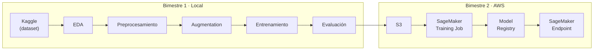

[⬅ Volver al README](../README.md)

# Documentación técnica

> Audiencia: quien tenga formación en programación/ciencia de datos y quiera entender el
> diseño del proyecto y el estado de las decisiones tomadas. Para la explicación en
> términos no técnicos, ver [`documentacion_no_tecnica.md`](documentacion_no_tecnica.md). Para el contrato
> formal del modelo, ver [`model_card.md`](model_card.md). Para el diagrama de infra en
> AWS, ver [`architecture.md`](architecture.md).

**Índice:** [Resumen del problema](#resumen-del-problema) ·
[Pipeline end-to-end](#pipeline-end-to-end) ·
[Estado de las decisiones](#estado-de-las-decisiones-de-diseño) ·
[Hallazgos del EDA](#hallazgos-del-eda-que-ya-condicionan-decisiones-posteriores) ·
[Convenciones de código](#convenciones-de-código-a-respetar) ·
[Setup](#setup-y-comandos) · [Próximos pasos](#próximos-pasos)

## Resumen del problema

Trabajo en una clasificación multiclase (4 clases: glioma, meningioma, pituitary,
notumor) de imágenes 2D de MRI cerebral, con transfer learning sobre un backbone
congelado. Ver [`README.md`](../README.md) para el objetivo general y el cronograma.

## Pipeline end-to-end

Divido el proyecto en dos fases con una regla de diseño central: **el mismo código de
`src/data/preprocessing.py` y `src/models/train.py` corre sin modificarse en ambas** —
prototipado local (Bimestre 1) y SageMaker (Bimestre 2). Por eso `train.py` lee
hiperparámetros y paths desde variables de entorno/CLI (convención SageMaker), nunca
hardcodeados.

## Estado de las decisiones de diseño

| Decisión | Estado | Detalle |
|---|---|---|
| Framework (PyTorch/TensorFlow) | **Resuelto: PyTorch** | Priorizo su vigencia en el mercado laboral y en investigación por sobre la curva de entrada más suave de Keras |
| Arquitectura (EfficientNet-B0/MobileNetV2) | **Resuelto: EfficientNet-B0** | Con el backbone congelado la diferencia de costo es irrelevante; pesa más su mejor accuracy de transferencia, dado que la métrica prioritaria es el recall |
| `image_size` | **Resuelto: 224×224** | Ver justificación abajo |
| `epochs`, `learning_rate` | **Resuelto (25/10/2026)** | Adam con `learning_rate = 0.001`; techo de 30 épocas con early stopping (paciencia 5) sobre el recall promedio de validación. En la corrida de referencia cortó en la época 20 y la mejor fue la 15. Resultados y curvas en la [model card](model_card.md) |
| `s3_bucket`, `region` | **Pendiente** | Bloquea Bimestre 2 |
| Split train/val/test | **Resuelto: 70/10/20** | Estratificado, seed fijo, deduplicado antes. Agrando el test para acotar el margen de error del recall por clase (±3.1 puntos en lugar de ±4.4) |
| Augmentation | **Resuelto** | Rotación ±10°, zoom ±10%, brillo/contraste ±40%, sin flip. Ver hallazgos del EDA abajo |

## Hallazgos del EDA que ya condicionan decisiones posteriores

Ya terminé el EDA, que vive en `notebooks/01_eda.ipynb` (corre local, ver sección de
Setup del proyecto). Resumo acá lo relevante para cuando implemente
`preprocessing.py` / `augmentation.py` / `train.py`:

### 1. Balance de clases

7.200 imágenes, exactamente 1.800 por clase (25% cada una). **Dataset perfectamente
balanceado** → no hacen falta class weights ni sampling especial en la loss.

**Después de deduplicar** (ver punto 5) el balance ya no es perfecto: quedan 7.013
imágenes y notumor, la clase que concentraba los duplicados, baja a ~24% del train
contra ~25-25.5% del resto (relación máximo/mínimo de 1.06). Mantengo la decisión de no
balancear, por tres motivos:

- **El desbalance es despreciable.** Los class weights equivalentes quedarían entre 0.98
  y 1.04, sin efecto práctico. Como referencia, el desbalance suele empezar a importar a
  partir de una relación de 1.5-2.
- **Las alternativas cuestan más de lo que corrigen.** El undersampling descartaría ~200
  imágenes de train, y el oversampling volvería a introducir imágenes repetidas, que es
  justamente lo que acabo de eliminar.
- **El sesgo residual va en la dirección segura.** Con algunos ejemplos menos de
  notumor, el modelo tiende levemente a predecir *menos* "sin tumor", que es el error
  clínicamente costoso. Si el efecto llegara a notarse, favorecería el recall de las
  clases con tumor.

La evaluación no se ve afectada: el test está estratificado, así que el recall de cada
clase se mide sobre la proporción real.

### 2. Resolución elegida: `image_size = 224`

Con `recomendar_image_size()` comparé 150/224/256 contra la distribución real de
resoluciones (dominante: 512×512, 70% del dataset). Descarté 150 porque, aunque casi no
requiere upscaling (0.6%), reduce la mayoría del dataset a menos del 10% de su resolución
original sin necesidad. Elegí 224 por alinear con la resolución preentrenada estándar de
EfficientNet-B0/MobileNetV2 sobre ImageNet, aceptando upscaling en el 11.3% de las
imágenes más chicas (vs. 18.8% con 256, por un beneficio marginal).

### 3. Mezcla de tipos de corte (axial/sagital/coronal) sin etiquetar

El dataset no trae metadata de orientación (ni en nombre de archivo ni en archivo
aparte), y mezcla las tres orientaciones estándar de MRI sin indicarlo, incluso dentro de
una misma clase. **Decisión:** saco el flip horizontal del augmentation. Un flip
horizontal es válido en cortes axiales/coronales (el cerebro es aproximadamente simétrico
izquierda-derecha) pero inválido en cortes sagitales (invierte adelante-atrás, generando
una imagen anatómicamente imposible). Sin forma barata de detectar la orientación por
imagen, prefiero no arriesgarme a corromper el subconjunto sagital.

### 4. Diferencias sistemáticas de intensidad/contraste por clase — probable artefacto de composición

Con `estadisticas_intensidad()` encontré diferencias marcadas de brillo, contraste y
fracción de fondo negro entre clases (glioma la más oscura, "sin tumor" la más clara y
contrastada). Investigando la composición documentada del dataset (Kaggle + IEEE
DataPort): la clase **notumor proviene 100% de Br35H**, mientras que **glioma viene de
figshare** y **meningioma/pituitario mayormente de SARTAJ** — fuentes con protocolos de
adquisición distintos. La correlación que veo coincide con la composición por fuente, no
con una diferencia clínica confirmada.

**Decisión:** el augmentation de brillo/contraste no es opcional — es mi mitigación
directa contra el riesgo de que el modelo aprenda a distinguir "de qué fuente vino la
imagen" en vez de patología real. Lo documento también como limitación en
[`model_card.md`](model_card.md).

**Cuantificación del atajo (19/10/2026).** Para medir qué tan fuerte es esta señal,
entrené una regresión logística que solo recibe **dos números por imagen: brillo medio y
desvío** (sin ninguna información de forma ni de textura), sobre una muestra de 2.000
imágenes (70/30 estratificado). El experimento es reproducible en
`notebooks/02_preprocessing_debug.ipynb`, sección 3:

| Escenario | Accuracy | Recall notumor |
|---|---|---|
| Azar | 0.25 | — |
| Sin augmentation | **0.63** | 0.55 |
| ColorJitter brillo/contraste 0.2 | 0.62 | 0.51 |
| ColorJitter brillo/contraste 0.4 | 0.61 | 0.52 |
| ColorJitter brillo/contraste 0.6 | 0.60 | 0.53 |
| Normalización por imagen (media 0, desvío 1)¹ | 0.56 | 0.49 |

¹ Con la normalización por imagen, el brillo y el desvío quedan constantes y no informan
nada; el clasificador usa en su lugar la forma del histograma (percentiles 1 y 99
estandarizados y fracción de fondo negro).

Conclusiones:

- **Dos estadísticos de intensidad alcanzan para acertar el 63%**, más del doble que el
  azar. Lo que en el EDA era una sospecha visual pasa a ser una señal medida.
- **El augmentation de brillo/contraste casi no la reduce** (0.63 → 0.61). Es simétrico:
  ensancha la distribución de cada clase pero no mueve su promedio, así que notumor sigue
  siendo en promedio más brillante. Además se aplica solo a train, y test conserva el
  sesgo intacto.
- **La normalización por imagen la reduce más (0.56), pero no la elimina.** La forma del
  histograma sigue delatando la fuente y, a la vez, mezcla información anatómica real,
  por lo que no se puede limpiar sin perder señal útil.
- **El origen del problema es el armado del dataset, no el preprocesamiento.** Mientras
  "sin tumor" provenga de una única fuente, la fuente y la etiqueta quedan confundidas, y
  como test proviene de las mismas fuentes, su métrica no puede detectar si el modelo usa
  el atajo.

**Decisiones derivadas:**

- Mantengo ColorJitter en 0.4. No resuelve el atajo, pero vuelve al modelo más robusto a
  diferencias de intensidad entre equipos de resonancia, lo que tiene valor propio.
- No incorporo la normalización por imagen por ahora: la mejora es moderada frente a la
  complejidad que agrega. Queda como experimento posible.
- En la evaluación voy a incluir una **prueba de estrés de brillo**: modificar
  artificialmente el brillo de imágenes de test con tumor y medir si el modelo empieza a
  predecir "sin tumor". Es la forma de comprobar si el modelo final usa el atajo, algo
  que la métrica de test por sí sola no puede mostrar.

**Resultado de la prueba de estrés (25/10/2026):** el brillo global no es la señal
principal del modelo. Con las imágenes en su brillo original, el 1,3% de los tumores de
test se predice como "sin tumor"; al aclararlas un 80% (factor 1,8, la relación de brillo
medida entre notumor y glioma), esa proporción sube a 3,7%. Al oscurecer a la mitad las
imágenes sin tumor, su reconocimiento baja apenas de 98,8% a 96,7%. Extendí el rango
hasta 1,8 porque el augmentation ya cubre de 0,6 a 1,4 y dentro de ese rango la robustez
es esperable por construcción. La prueba no descarta otros atajos de la fuente, en
particular el tipo de secuencia (punto 6). Tabla completa en la
[model card](model_card.md).

### 5. Duplicados exactos: 4.72% del dataset

Con `detectar_duplicados()` encontré 340 archivos (153 grupos) duplicados byte a byte,
ninguno cruzando clases distintas, concentrados en notumor (~64% de los duplicados) —
otra pista a favor del hallazgo anterior. **Decisión:** deduplico antes del split
estratificado propio (`preprocessing.split_dataset()`), no del split Training/Testing
original de Kaggle — este último no me protege contra fuga de datos porque lo descarto.

### 6. Las clases difieren en el tipo de secuencia de resonancia (19/10/2026)

Al verificar visualmente el augmentation, revisé 10 imágenes al azar por clase y encontré
un patrón que el análisis de intensidades no mostraba:

- **glioma, meningioma y pituitario** son, casi en su totalidad, de un mismo tipo de
  secuencia: líquido cefalorraquídeo oscuro, parénquima gris y lesión realzada.
  Visualmente corresponden a **T1 con contraste**.
- **notumor** mezcla secuencias: además de T1, aparecen imágenes con el líquido
  cefalorraquídeo brillante (compatibles con **T2**) y otras compatibles con **FLAIR**.

La identificación es visual y no la hizo un especialista; queda pendiente de
confirmación por un profesional médico. La grilla de imágenes por clase sobre la que se
basa está en `notebooks/02_preprocessing_debug.ipynb`, sección 4.

**Por qué es más grave que la diferencia de brillo:**

- **El augmentation no la corrige.** T1 y T2 no difieren en un brillo global sino en el
  contraste relativo entre tejidos (el líquido pasa de negro a blanco). Ninguna
  transformación de intensidad convierte una secuencia en otra.
- **Empuja hacia el error clínicamente costoso.** El modelo puede aprender "aspecto T2 →
  sin tumor". Ante una imagen T2 con tumor, la predicción probable sería "sin tumor", es
  decir, un falso negativo.

**Decisiones derivadas:**

- **Acoto el uso previsto del modelo a imágenes T1 con contraste**, la única secuencia
  representada en las clases con tumor. Queda registrado en la
  [model card](model_card.md).
- **Etiquetado manual de secuencias en la evaluación (pendiente):** clasificar a mano,
  idealmente con participación de un profesional médico, una muestra de imágenes
  notumor de test como T1 o T2/FLAIR, y comparar el recall del modelo en cada grupo. Si
  el modelo solo reconoce correctamente las T2/FLAIR, aprendió la secuencia y no la
  ausencia de tumor. Sigue la misma lógica que la prueba de estrés de brillo del punto 4.

## Convenciones de código a respetar

- Ya implementé `src/data/` (EDA, Dataset, split y augmentation) y `src/models/`
  (`architecture.py`, `train.py`, `evaluate.py`). El resto de `src/` son stubs con `NotImplementedError` cuyo
  docstring especifica el contrato a implementar.
- `src/inference/inference.py` implementa las 4 funciones fijas de SageMaker script mode
  (`model_fn`, `input_fn`, `predict_fn`, `output_fn`); nombres y firmas los impone
  SageMaker, no son negociables.
- `src/pipeline/sagemaker_pipeline.py` lo dejo como stretch goal opcional, no prioritario.
- Las restricciones duras de infra (on-demand sin Spot, sin GPU, preprocesamiento en
  Studio Notebook y no en Processing Job) están detalladas en `architecture.md` — no son
  preferencias de estilo, son lo que mantiene el proyecto dentro del free tier de AWS.

## Setup y comandos

Ver la sección "Cómo correr en local" de [`README.md`](../README.md) para el setup del
entorno (venv, kernel de Jupyter, credenciales de Kaggle).

## Próximos pasos

1. Etiquetado manual de secuencias (T1/T2/FLAIR) sobre una muestra de test, idealmente
   con un profesional médico (punto 6 de los hallazgos).
2. Tests de `train.py` (lógica de early stopping y congelamiento de BatchNorm).
3. Bimestre 2: subir a S3, resolver `s3_bucket`/`region`, portar `train.py` a SageMaker.

La evaluación sobre test (métricas por clase, matriz de confusión, ROC-AUC y prueba de
estrés de brillo) quedó completa el 25/10/2026; los resultados están en la
[model card](model_card.md).

---

**Ver también:** [documentación no técnica](documentacion_no_tecnica.md) ·
[model card](model_card.md) · [arquitectura en AWS](architecture.md) ·
[desarrollo asistido por IA](desarrollo_asistido_por_ia.md)
